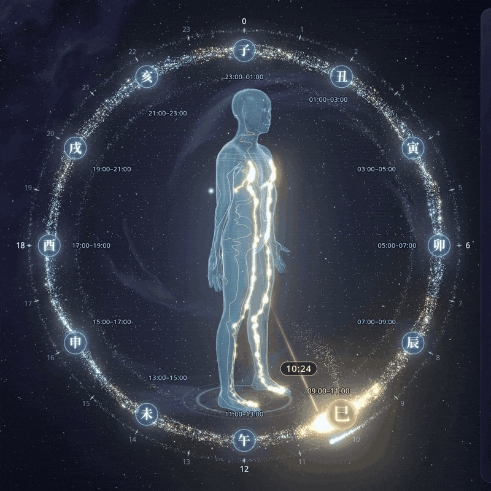
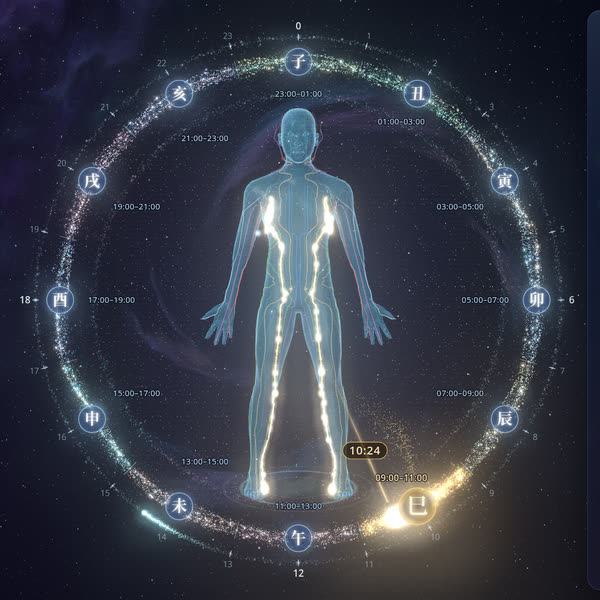
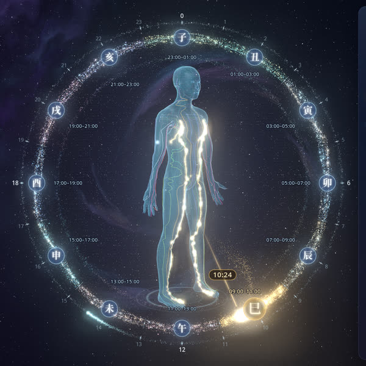
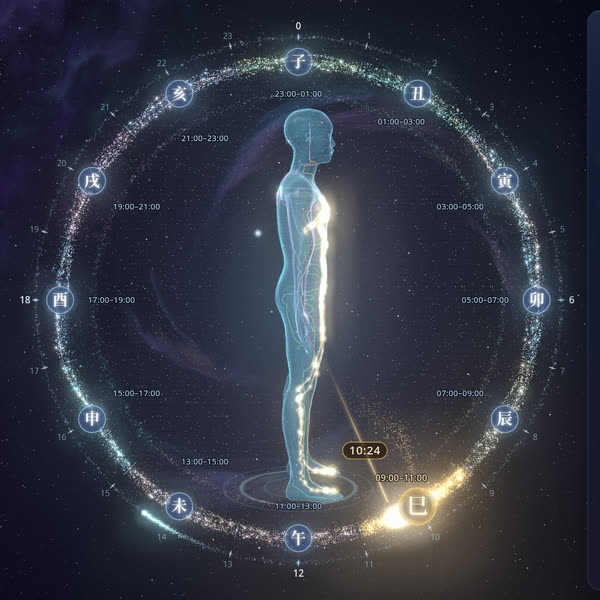
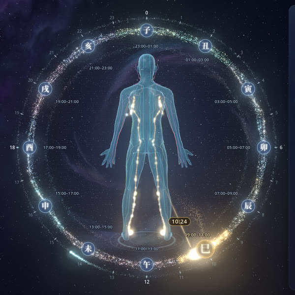

<div align="center">


# Ziwu Meridian Clock · 子午流注·经络全息钟

**A 3D live wallpaper for Windows: a holographic human body whose 12 meridians light up through the 12 traditional Chinese double-hours, on Beijing time.**

[](https://github.com/jeson998/ziwu-meridian-clock/releases/latest)
[](https://github.com/jeson998/ziwu-meridian-clock/releases)
[](LICENSE)
[](#install)
[](https://dotnet.microsoft.com/)
[](https://threejs.org/)

[简体中文](README.md) · **English**



</div>

## Features

- **Holographic 3D body** that rotates slowly through 360°: 90, 60 or 30 s per turn, or stopped facing front.
- **12 meridians as 3D tubes** that follow textbook pathways. Each has its own colour and is mirrored left and right.
- **The active meridian glows gold**, with particles flowing in its correct direction. When the body turns away, the hidden parts show through as a depth-aware x-ray.
- **Particle star-ring dial** of about 32k GPU particles. The current time is a golden comet and the seconds are a cyan spark.
- **Glassmorphism info panel** showing Beijing time, the active meridian, its start and end acupoints, the progress through the double-hour, and 5 do's and 5 don'ts.
- **Real wallpaper layer**: the page is embedded behind the desktop icons using the WorkerW method, including on Win11 24H2. It recovers automatically after Explorer restarts, display changes, or sleep.
- **Light on resources**: it pauses while a fullscreen app is in front and slows down on battery. There are 3 quality levels plus a safe mode.
- **Fully offline**: a single self-contained exe; no separate .NET install is needed.

## Screenshots

| Front | 45° | Side | Back (x-ray) |
|:--:|:--:|:--:|:--:|
|  |  |  |  |

## Install

1. Download `ZiwuMeridianClock-v1.0.0-win-x64.zip` from [Releases](https://github.com/jeson998/ziwu-meridian-clock/releases/latest).
2. Unzip all of it (keep `web\` next to the exe) and run `ZiwuMeridianClock.exe`.
3. Requirements:
   - Windows 10 1809+ or Windows 11, 64-bit;
   - the [WebView2 Runtime](https://go.microsoft.com/fwlink/p/?LinkId=2124703), which is preinstalled on most systems;
   - a WebGL2-capable GPU.

> The exe is not code-signed. If SmartScreen appears, click **More info → Run anyway**. You can check the download against `SHA256SUMS.txt`.

Right-click the tray icon to show or hide the wallpaper and to set autostart, quality, rotation speed, multi-monitor, display mode and safe mode.
**Lively Wallpaper** alternative: import `web/index.html` or the `-web.zip`.

## The 12 double-hours

| Double-hour | Beijing time | Meridian | Direction |
|:--:|:--:|:--:|:--:|
| 子 | 23:00–01:00 | GB | Head → Foot |
| 丑 | 01:00–03:00 | LR | Foot → Abdomen/Chest |
| 寅 | 03:00–05:00 | LU | Chest → Hand |
| 卯 | 05:00–07:00 | LI | Hand → Head |
| 辰 | 07:00–09:00 | ST | Head → Foot |
| 巳 | 09:00–11:00 | SP | Foot → Abdomen/Chest |
| 午 | 11:00–13:00 | HT | Chest → Hand |
| 未 | 13:00–15:00 | SI | Hand → Head |
| 申 | 15:00–17:00 | BL | Head → Foot |
| 酉 | 17:00–19:00 | KI | Foot → Abdomen/Chest |
| 戌 | 19:00–21:00 | PC | Chest → Hand |
| 亥 | 21:00–23:00 | TE | Hand → Head |

## Build from source

```bash
scripts/build.sh        # Linux/macOS cross-build (.NET 8 SDK)
```
```powershell
.\scripts\build.ps1     # Windows
```

To preview only the web part, run `cd web && python -m http.server 8765` and open `http://127.0.0.1:8765/index.html?preview=1`.
See [docs/ARCHITECTURE.md](docs/ARCHITECTURE.md) for how it works.

## Disclaimer

The meridian and health content is based on Traditional Chinese Medicine theory. It is provided for cultural and educational purposes only and **is not medical advice**.

## License

[MIT](LICENSE) © 2026 jeson998. For third-party assets (three.js MIT, MakeHuman CC0 mesh, Noto fonts OFL 1.1, WebView2 SDK), see [THIRD_PARTY_NOTICES.md](THIRD_PARTY_NOTICES.md).
