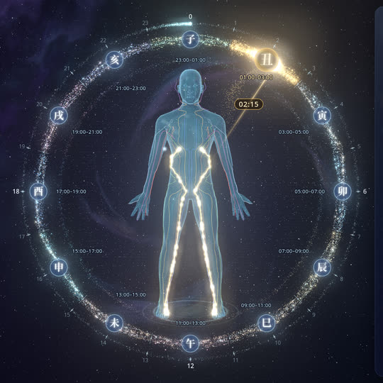
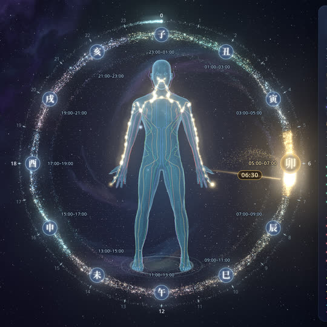
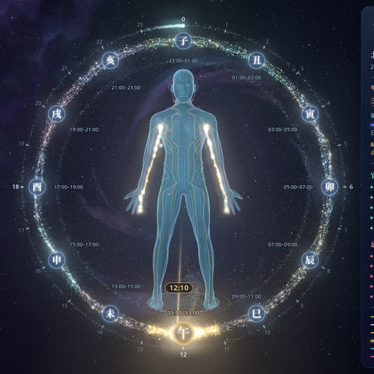
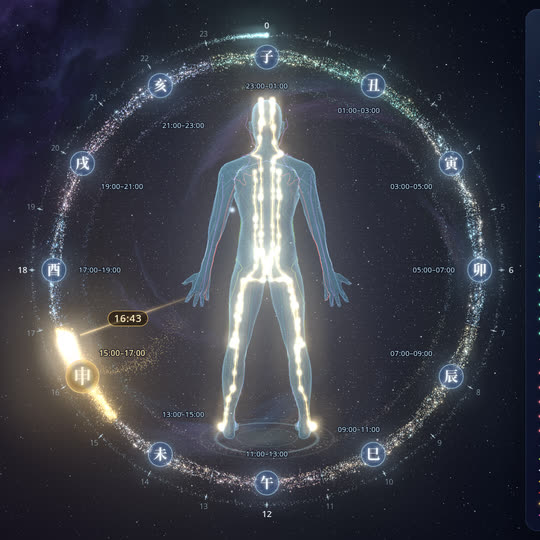
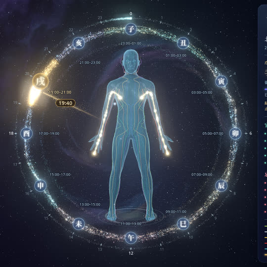
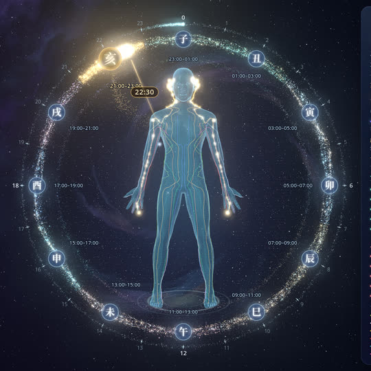
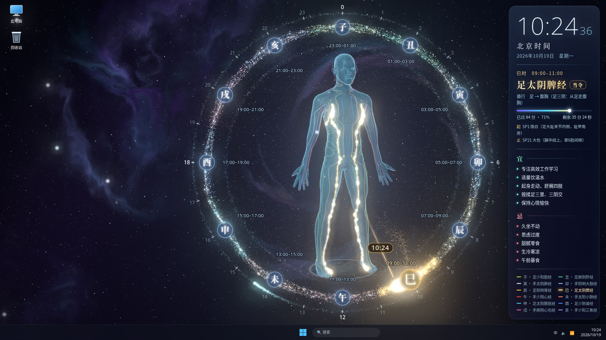
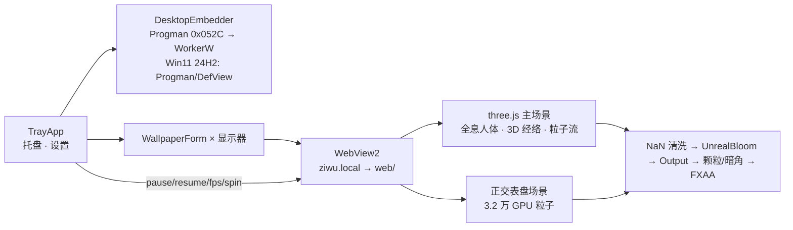

<div align="center">


# 子午流注·经络全息钟

**Windows 3D 动态桌面壁纸 · 北京时间十二时辰 · 当令经络实时流注**

*一具缓缓旋转的全息人体，十二经络依时辰轮流点亮，星尘环绕成钟。*

[](https://github.com/jeson998/ziwu-meridian-clock/releases/latest)
[](https://github.com/jeson998/ziwu-meridian-clock/releases)
[](LICENSE)
[](#-下载安装)
[](https://dotnet.microsoft.com/)
[](https://threejs.org/)
[](https://github.com/jeson998/ziwu-meridian-clock/actions/workflows/ci.yml)

**简体中文** · [English](README.en.md)


<sub>▶ 高清视频：<a href="https://github.com/jeson998/ziwu-meridian-clock/releases/download/v1.0.0/demo.mp4">demo.mp4（Release 附件）</a> · 演示为 30 秒/圈转速</sub>

</div>

---

## ✨ 功能特性

- 🧍 **全息 3D 人体**：通透的玻璃/玉质质感，有主光、边缘光、近亮远暗和柔和的褶皱阴影，脚下有地面光盘和接触阴影，旋转时立体感明显。
- 🔄 **360° 缓慢旋转**：可选 90 / 60 / 30 秒一圈，或停在正面；转到正面时会略微放慢。
- 🌈 **十二经络 3D 路线**：每条经络按教材循行路线贴着体表走，左右对称，各用一种颜色，并画成略微凸起的立体管道。
- ✨ **当令经络金光流注**：按北京时间自动高亮当令经络，粒子沿正确方向流动，带行进脉冲和穴位呼吸光点。
- 🩻 **深度感知 X 光**：转到背面时，被身体挡住的经络仍以较淡的光显示（当令经络约 45%，其余约 30%），路线始终能跟上。
- 🌌 **粒子星环表盘**：约 3.2 万颗 GPU 粒子组成星尘带，十二时辰是星座式节点；当前时刻是一颗金色彗星，秒针是一颗青色火花。
- 🪟 **玻璃拟态信息面板**：北京时间、日期、当令经络、起止穴与走向、本时辰进度，以及 5 条宜、5 条忌。
- 🖥 **真·动态壁纸**：画面嵌在桌面图标之后，图标照常点击；Explorer 重启、分辨率变化、休眠唤醒后会自动恢复。
- ⚡ **省心省电**：前台有全屏游戏/程序时自动暂停，用电池时自动降帧，最高 30 fps；画质分高/中/低三档。
- 📐 **自适应布局**：支持 1366×768 到 4K、高 DPI 和带鱼屏；自动避开任务栏，左侧约 40% 留给桌面图标。
- 🕐 **永远北京时间**：按 UTC+8 计算，与系统时区无关。
- 📦 **完全离线**：three.js、模型、字体全部内置，单文件 exe 不需要另装 .NET。

## 📸 截图

<table>
<tr>
<td align="center"><br/><sub>正面</sub></td>
<td align="center"><br/><sub>45°</sub></td>
<td align="center"><br/><sub>侧面</sub></td>
<td align="center"><br/><sub>背面（X 光透视当令经络）</sub></td>
</tr>
</table>

<details open>
<summary><b>不同时辰</b></summary>

| 丑时 01:00–03:00 · 足厥阴肝经 | 卯时 05:00–07:00 · 手阳明大肠经 | 午时 11:00–13:00 · 手少阴心经 |
|:--:|:--:|:--:|
|  |  |  |
| **申时 15:00–17:00 · 足太阳膀胱经** | **戌时 19:00–21:00 · 手厥阴心包经** | **亥时 21:00–23:00 · 手少阳三焦经** |
|  |  |  |

</details>

<details>
<summary><b>桌面整体效果（1920×1080）</b></summary>



</details>

## 📥 下载安装

1. 前往 [**Releases**](https://github.com/jeson998/ziwu-meridian-clock/releases/latest) 下载 `ZiwuMeridianClock-v1.0.0-win-x64.zip`。
2. **完整解压**到一个固定文件夹（`ZiwuMeridianClock.exe` 和 `web\` 必须在同一目录），然后双击 exe。
3. 任务栏右下角出现太极托盘图标，说明已经运行。

| 项目 | 要求 |
|---|---|
| 系统 | Windows 10 1809+ / Windows 11（含 24H2），64 位 |
| 运行时 | [Microsoft Edge WebView2](https://go.microsoft.com/fwlink/p/?LinkId=2124703)（Win11 和大多数 Win10 已自带；缺少时程序会提示下载） |
| 显卡 | 支持 WebGL2 的核显或独显；建议“高”画质用独显或较新的核显 |
| .NET | 不需要安装（exe 已自包含 .NET 8） |

> [!NOTE]
> **SmartScreen / 杀毒软件提示**：程序没有购买代码签名证书，首次运行可能出现“Windows 已保护你的电脑”，点 **更多信息 → 仍要运行** 即可。
> 嵌入桌面需要调用 `SetParent`，开机自启会写入 `HKCU\…\Run`，个别杀毒软件可能误报，请把程序加入信任。可以用 Release 附带的 `SHA256SUMS.txt` 校验文件。

## 🖱 使用

右键托盘太极图标：

| 菜单 | 说明 |
|---|---|
| **显示 / 隐藏** | 临时隐藏壁纸，隐藏期间停止渲染、不占显卡（双击托盘图标也可以） |
| **开机自启** | 登录时自动启动（写入当前用户的 Run 注册表项，不需要管理员权限） |
| **画质** | **高**：30 fps，全部粒子，MSAA×4 · **中**：24 fps，60% 粒子，FXAA · **低**：15 fps，35% 粒子，省电 |
| **旋转速度** | 慢（90 秒/圈）· 中（60 秒/圈，默认）· 快（30 秒/圈）· 停止（正面） |
| **高级** | 在所有显示器显示 · 全屏程序时暂停 · 显示模式（桌面壁纸层 / 兼容模式）· 重新嵌入桌面 · **安全模式** · 打开日志目录 |
| **退出** | 关闭程序并恢复原来的壁纸 |

- **安全模式**会关闭褶皱暗化、MSAA 和 Bloom，用来排查个别显卡上的画面问题（见 [FAQ](#-faq)）。
- 设置保存在 `%LOCALAPPDATA%\ZiwuMeridianClock\settings.json`，日志写在同目录的 `log.txt`。

## 🕰 十二时辰对照表

| 时辰 | 北京时间 | 当令经络 | 起止穴 | 走向 | 宜 | 忌 |
|:--:|:--:|---|---|:--:|---|---|
| **子** | 23:00–01:00 | 足少阳胆经 GB | GB1 瞳子髎 → GB44 足窍阴 | 头 → 足 | 23点前入睡，睡前泡脚 | 熬夜、夜宵 |
| **丑** | 01:00–03:00 | 足厥阴肝经 LR | LR1 大敦 → LR14 期门 | 足 → 腹胸 | 深睡养肝，环境安静 | 饮酒、动怒、刷手机 |
| **寅** | 03:00–05:00 | 手太阴肺经 LU | LU1 中府 → LU11 少商 | 胸 → 手 | 熟睡，保暖护胸背 | 受凉吹风、吸烟 |
| **卯** | 05:00–07:00 | 手阳明大肠经 LI | LI1 商阳 → LI20 迎香 | 手 → 头 | 起床喝温水，定时排便 | 憋便、空腹冷饮 |
| **辰** | 07:00–09:00 | 足阳明胃经 ST | ST1 承泣 → ST45 厉兑 | 头 → 足 | 按时吃温热早餐 | 不吃早餐、生冷油腻 |
| **巳** | 09:00–11:00 | 足太阴脾经 SP | SP1 隐白 → SP21 大包 | 足 → 腹胸 | 专注工作，起身活动 | 久坐、思虑过度 |
| **午** | 11:00–13:00 | 手少阴心经 HT | HT1 极泉 → HT9 少冲 | 胸 → 手 | 小憩 15–30 分钟 | 剧烈运动、大喜大悲 |
| **未** | 13:00–15:00 | 手太阳小肠经 SI | SI1 少泽 → SI19 听宫 | 手 → 头 | 饭后缓步，多饮水 | 饭后即卧、辛辣 |
| **申** | 15:00–17:00 | 足太阳膀胱经 BL | BL1 睛明 → BL67 至阴 | 头 → 足 | 多喝水，适当运动 | 憋尿、久坐不饮水 |
| **酉** | 17:00–19:00 | 足少阴肾经 KI | KI1 涌泉 → KI27 俞府 | 足 → 腹胸 | 晚餐清淡，泡脚 | 过劳、过咸 |
| **戌** | 19:00–21:00 | 手厥阴心包经 PC | PC1 天池 → PC9 中冲 | 胸 → 手 | 散步，愉快交谈 | 情绪压抑、饱食即卧 |
| **亥** | 21:00–23:00 | 手少阳三焦经 TE | TE1 关冲 → TE23 丝竹空 | 手 → 头 | 静卧，准备入眠 | 熬夜玩手机、浓茶 |

> 起止穴、走向依据常见中医经络教材整理；宜/忌为程序内每个时辰 5 条建议的摘要。

## 🦎 Lively Wallpaper 备用方案

exe 在你的电脑上有问题时，可以用免费开源的 [Lively Wallpaper](https://www.rocksdanister.com/lively/)（Microsoft Store 可安装）：

1. 下载 `ZiwuMeridianClock-v1.0.0-web.zip`，或使用完整包里的 `web\` 文件夹。
2. 在 Lively 中点 **＋ 添加壁纸**，选择 `web\index.html`，或直接把 zip 拖进去（已附带 `LivelyInfo.json`）。
3. 设为壁纸。可在地址后加参数：`?q=mid`（中画质）、`?spin=90`（慢速旋转）、`?safe=1`（安全模式）。

## 🛠 从源码构建

```bash
# Linux / macOS 交叉编译（需 .NET SDK 8）
scripts/build.sh            # 输出 dist/ZiwuMeridianClock-v1.0.0-win-x64.zip、-web.zip、SHA256SUMS.txt
```

```powershell
# Windows（PowerShell，需 .NET SDK 8）
.\scripts\build.ps1
```

只想看网页效果，不用编译：

```bash
cd web && python -m http.server 8765
# 浏览器打开 http://127.0.0.1:8765/index.html?t=10:24:36&preview=1
```

页面 URL 参数：`t=HH:MM:SS` 固定时间 · `rot=角度` 固定转角 · `spin=秒/圈` · `q=high|mid|low` · `safe=1` · `preview=1` 模拟桌面。

推送 `v*` 标签后，GitHub Actions 会在 `windows-latest` 上自动构建并发布 Release（`.github/workflows/release.yml`）。

## 📁 项目结构

```
ziwu-meridian-clock/
├─ web/                        # 网页（壁纸本体，可独立用于 Lively）
│  ├─ index.html               # three.js 场景、表盘、信息面板
│  ├─ meridians.js             # 十二经络数据（名称/颜色/起止穴/走向/二维锚点）
│  ├─ models/                  # body.bin/json（人体网格）、meridians3d.json（三维经络路线）
│  ├─ fonts/                   # Noto CJK / Noto Sans 子集（OFL）
│  ├─ lib/                     # three.js r160 及所用 addons（MIT）
│  └─ LivelyInfo.json
├─ src/ZiwuMeridianClock/      # C# .NET 8 WinForms + WebView2 桌面程序
├─ scripts/                    # build.sh（Linux 交叉编译）/ build.ps1（Windows）
├─ tools/                      # 离线资源管线：MakeHuman 网格重摆姿、经络射线映射（numpy）
├─ docs/                       # 截图、演示动画、架构说明、发布说明
├─ licenses/                   # 第三方许可证全文
└─ .github/                    # CI / Release 工作流、Issue/PR 模板
```

## ⚙️ 技术实现



- **桌面嵌入**：向 `Progman` 发送 `0x052C` 生成 `WorkerW`，再把窗口 `SetParent` 到图标层之后。Win11 24H2+ 改为放进 `Progman` 内、`SHELLDLL_DefView` 之下；都失败时改用置底、鼠标穿透的兼容窗口。
- **人体**：基于 MakeHuman CC0 网格，离线把手臂摆成掌心向前，再三角化。渲染时先写一遍深度（带 polygonOffset，防 z-fighting），再画加法混合的全息着色层：菲涅尔边缘光、包裹漫反射、玉质透光、近亮远暗、顶点 AO。
- **经络**：二维体表锚点（以“寸”为单位）经射线投射映射到网格表面，再用 Catmull-Rom 曲线生成 TubeGeometry。被身体挡住的部分用 `GreaterDepth` 单独画一遍，形成 X 光效果。
- **表盘**：所有粒子的轨道、扰动和闪烁都在顶点着色器里计算；文字用 SVG 叠加，保证清晰锐利。
- **后期处理**：EffectComposer + UnrealBloom，MSAA/FXAA 按画质切换，并在 Bloom 之前加了一道 NaN/Inf 清洗。

更多细节见 [docs/ARCHITECTURE.md](docs/ARCHITECTURE.md)。

## ❓ FAQ

<details>
<summary><b>人体上出现闪烁的小黑斑 / 画面闪烁？</b></summary>

v1.0.0 已修复已知原因：深度预写与全息表面 z-fighting、MSAA 兼容性、着色器 NaN。个别显卡如果仍有问题，请按顺序尝试：

1. **画质 → 中**：关闭 MSAA，改用 FXAA。
2. **高级 → 安全模式**：关闭褶皱暗化、MSAA、Bloom。
3. 更新显卡驱动。

如果问题仍在，请提交 [Issue](https://github.com/jeson998/ziwu-meridian-clock/issues/new/choose)，附上显卡型号、`winver` 截图和 `log.txt`，并说明哪一步起了作用。
</details>

<details>
<summary><b>占用多少资源？</b></summary>

- **高**画质：在主流核显上 GPU 占用约 5–15%（30 fps 上限）。
- **低**画质：15 fps，适合笔记本。
- 前台有全屏程序或游戏、锁屏、隐藏时会暂停渲染；用电池时降到 20 fps，开启省电模式时降到 10 fps。
- 内存主要是 WebView2 进程，约 150–300 MB。
</details>

<details>
<summary><b>多显示器怎么用？</b></summary>

默认只在主显示器显示。托盘 → 高级 → **在所有显示器显示**后，每个显示器各显示一份，并按各自的分辨率和缩放自动排版。
</details>

<details>
<summary><b>桌面没有变化 / 黑屏？</b></summary>

依次尝试：托盘 → 高级 → **重新嵌入桌面**；改用 **兼容模式**；查看 `log.txt` 中的“嵌入成功: …”或错误信息；或者改用上面的 Lively 方案。
</details>

<details>
<summary><b>如何卸载？</b></summary>

1. 取消“开机自启”，然后退出程序。
2. 删除程序文件夹。
3. 可选：删除 `%LOCALAPPDATA%\ZiwuMeridianClock`（设置、日志、缓存）。
</details>

## 🗺 Roadmap

- [ ] 女性人体模型可选
- [ ] 点击穴位/经络显示说明（交互模式）
- [ ] 更多主题配色（水墨、赛博、极简）
- [ ] 节气与五运六气信息
- [ ] 繁体中文 / 英文界面切换
- [ ] 代码签名，以及 winget / Scoop 安装
- [ ] macOS 版（WKWebView 壁纸）

欢迎在 [Issues](https://github.com/jeson998/ziwu-meridian-clock/issues) 中提出建议。

## ⚠️ 免责声明

本项目展示的子午流注、经络循行和宜忌内容整理自中医传统理论，**仅供文化欣赏与养生科普参考，不构成任何医疗建议**。身体不适请咨询专业医生。

## 📄 License

代码采用 [MIT License](LICENSE) © 2026 jeson998。第三方资源（three.js — MIT、MakeHuman 人体网格 — CC0、Noto 字体 — OFL 1.1、WebView2 SDK）详见 [THIRD_PARTY_NOTICES.md](THIRD_PARTY_NOTICES.md)。

## 🙏 致谢

- [three.js](https://threejs.org/)：WebGL 渲染与后期处理
- [MakeHuman](http://www.makehumancommunity.org/)：CC0 人体基础网格
- [Noto CJK](https://github.com/notofonts/noto-cjk)：思源 / Noto 中文字体
- [Microsoft WebView2](https://developer.microsoft.com/microsoft-edge/webview2/) 与 [.NET](https://dotnet.microsoft.com/)
- [Lively Wallpaper](https://github.com/rocksdanister/lively)：WorkerW 嵌入方案的参考与备用方案
- 历代中医典籍与经络腧穴学教材

<div align="center"><sub>如果这个项目让你的桌面更有意思，欢迎点一个 ⭐ Star</sub></div>
