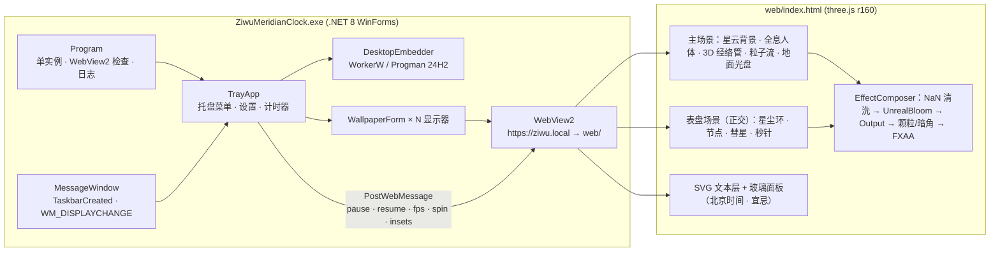

# 架构说明 / Architecture

## 桌面嵌入（WorkerW）
1. 先向 `Progman` 发送消息 `0x052C`，Explorer 会在桌面图标层（`SHELLDLL_DefView`）后面生成壁纸层 `WorkerW`。
2. **经典结构**（Win10 / Win11 23H2 及更早）：`SHELLDLL_DefView` 位于一个顶层 `WorkerW` 中，它后面的兄弟 `WorkerW` 就是壁纸层。程序把窗口 `SetParent` 到这个兄弟 `WorkerW`。
3. **Win11 24H2+**：`SHELLDLL_DefView` 与壁纸 `WorkerW` 都是 `Progman` 的子窗口。程序把窗口 `SetParent(Progman)`，z 序放在 DefView 之下、子 `WorkerW` 之上。
4. 如果以上都失败，改用**兼容模式**：置底窗口，样式为 `WS_EX_TRANSPARENT | WS_EX_LAYERED | WS_EX_NOACTIVATE | WS_EX_TOOLWINDOW`，鼠标点击穿透到桌面。
5. 两种情况会触发重新嵌入：
   - 收到 `TaskbarCreated`（Explorer 重启）或 `WM_DISPLAYCHANGE`，以及 SystemEvents 的分辨率变化或唤醒事件；
   - 看门狗每 5 秒检查一次，发现父窗口已失效。
6. WebView2 启动参数里关闭了 Chromium 的窗口遮挡检测（`--disable-features=CalculateNativeWinOcclusion` 等），否则窗口位于图标层之后时会被判定为“不可见”而停止渲染。
7. 页面文件由程序自己提供（`WebResourceRequested`），并显式设置 MIME 类型。这样即使某台电脑的注册表把 `.js` 标成 `text/plain`，也不会拦截 ES 模块。

## 渲染要点
- **人体**分三层：先写一遍深度（`colorWrite:false`，带 polygonOffset），再画全息着色层（加法混合），最后叠加线框和点云。
  - 全息着色层包含：菲涅尔边缘光、主光漫反射、玉质内透光、近亮远暗、顶点 AO。
- **经络**用 TubeGeometry 画成 3D 管：
  - 可见部分正常绘制（`LessEqual`）；
  - 被身体挡住的部分用 `GreaterDepth` 再画一遍，以较低强度显示（X 光效果）。
  - 当令经络另有流动粒子、脉冲和穴位点。
- **表盘**是单独的正交场景，坐标以设计半径 427 为单位，按屏幕整体缩放；粒子运动全部在 GPU 顶点着色器中计算。
- **后期处理**：MSAA（仅“高”画质）→ NaN/Inf 清洗 → UnrealBloom → OutputPass → 颗粒/暗角 → FXAA（中/低画质）。
- **时间**：始终按 UTC+8 计算北京时间。时辰序号 = `floor(((h+1)%24)/2)`；子时对应胆经，依次为子胆、丑肝、寅肺、卯大肠、辰胃、巳脾、午心、未小肠、申膀胱、酉肾、戌心包、亥三焦。

## 资源管线（`tools/`）
- `tools_build.py`：读取 MakeHuman 的 `base.obj`，叠加体型 targets，把手臂重新摆成掌心向前、略外展的姿势，再三角化，输出 `body.bin`。
- `tools_map.py`：把二维经络锚点（以“寸”为单位的体表坐标系）通过射线投射映射到三维网格表面，生成 `meridians3d.json`。
- 这两个脚本是一次性的离线工具，依赖 numpy，脚本中的路径需按需调整。日常构建不需要运行它们。
